  

# Ivander Nathanael K. / N4th0wl

CTF player and security researcher. Cloud and cybersecurity enthusiast.
I like figuring out why something works, and where it stops working.

[Repositories](https://github.com/N4ht0wl?tab=repositories) · [Activity](https://github.com/N4th0wl?tab=overview)

 

**What I spend time on**

| Focus | What I'm exploring |
| :--- | :--- |
| Pwn | Memory corruption, ROP, heap exploitation |
| Web | Injection, auth bypass, server-side bugs |
| Reversing | Binaries, decompilers, debuggers |
| Programming | Automation, exploit scripting, tooling |
| DevSecOps | CI/CD security, cloud infra, container hardening |

## My Tech Stack

**Web**

**Mobile**

**Databases**

**Languages**

## Tools

**Development**

**Security, Reversing and Pwn**

## Systems & Infrastructure

**Operating Systems**

**Scripting**

**Servers and Remote Access**

**Virtualization and Containers**

## Currently Learning

## Miscellaneous

 

  
  A little Owl want to get better in CTF.

 

# Github Stats

  
  
   
  

A few things I'm working toward

- Getting better at pwn, web, and reverse engineering through CTFs.
- Going deeper into cloud security and DevSecOps.
- Building more with Kotlin and Node.js, and writing better tooling and exploit scripts.
- Writing better CTF challenges.

